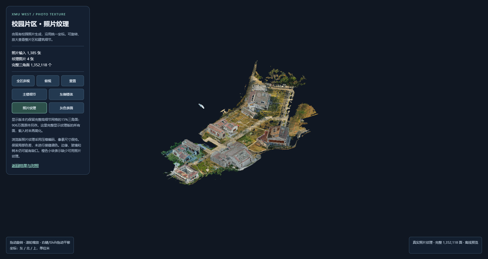
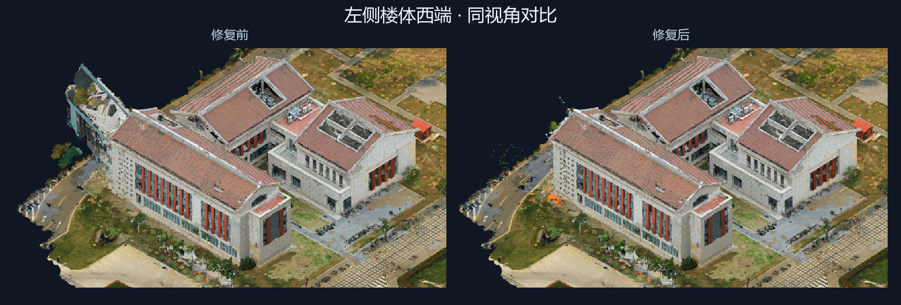

# XMU-West 校园片区模型 · 2026-11-07

这版修复了居中靠左楼体西端错位伸出的屋顶和立面。用现场照片和单栋楼旧点云核对真实西端墙的位置后，清除了重复表面。墙脚仍有少量碎片及未贴图区域。

照片纹理版包含 1,352,118 个三角面，完整网格包含 9,011,900 个三角面。下载包内含两份 GLB、完整 PLY、离线查看器和对比图。解压后在 Chrome 或 Edge 中打开 `results.html`。

完整下载包已生成并通过校验，等待上传至 [GitHub Releases](https://github.com/yk-amz/XMU-West/releases)。

[文件清单](release_manifest.json) · [下载包 SHA-256](SHA256SUMS)
